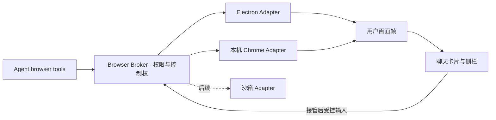
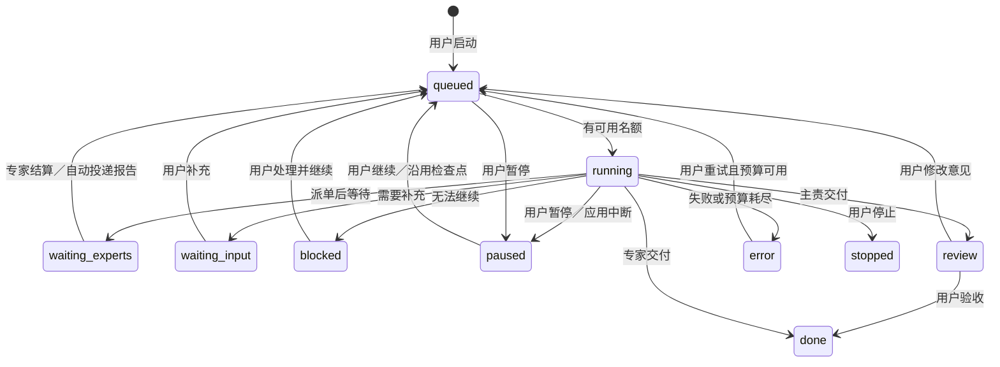
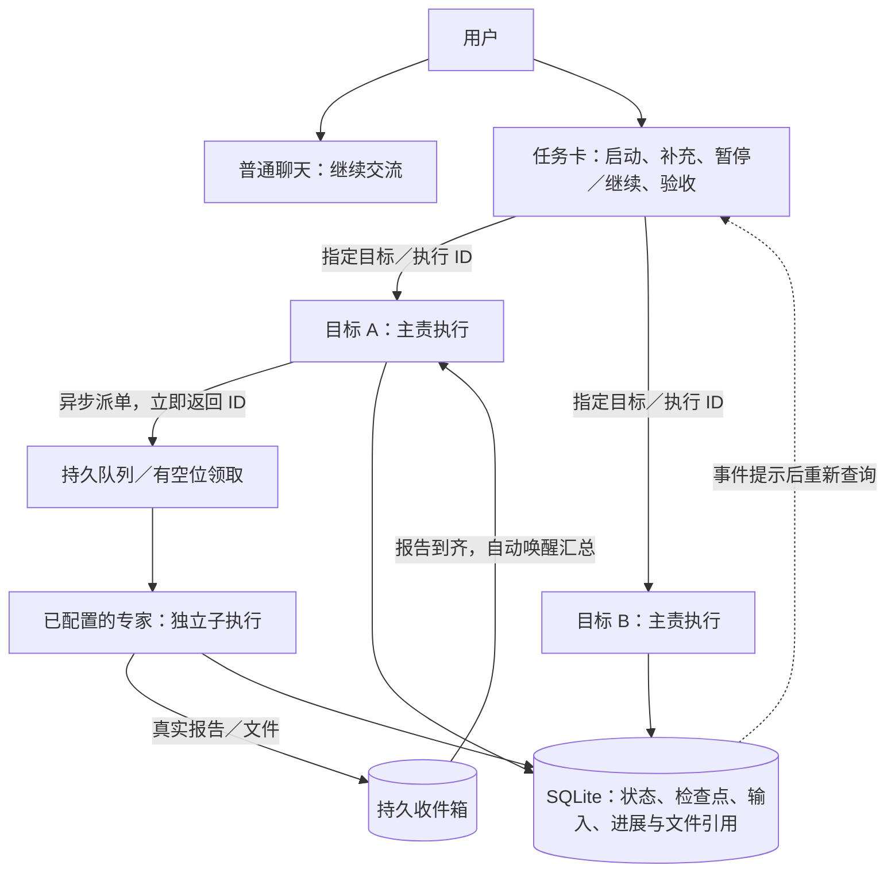
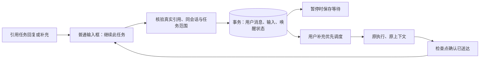

# ARCHITECTURE — Covan 技术方案

> 活文档 · 与 [SPEC](SPEC.md) 保持一致；本文档解释技术决策与内部设计，不另行定义产品需求；明确标注「待实施」的章节只描述候选方案，不代表当前能力或生效接口。

## 1. 总览

Covan 是标准 Electron 双进程 + preload 桥接架构。所有 LLM 调用、数据库、编排逻辑集中在主进程；渲染进程是纯 React UI，仅通过 `window.covan` 白名单 API 与事件订阅通信。

```
┌────────────────────────────────────────────────────────────┐
│ Renderer Process（React 18 + zustand + Tailwind）          │
│  Sidebar │ ChatView │ BotSettingsPanel │ SettingsModal     │
│      stores(bots/chats/messages/settings)                  │
│      lib/api.ts ── window.covan（类型化封装）              │
└───────────────▲───────────────────────────▲────────────────┘
   IPC invoke   │  （contextBridge 白名单）   │  webContents.send
┌───────────────┴───────────────────────────┴────────────────┐
│ Preload（contextBridge.exposeInMainWorld('covan', api)）  │
│  contextIsolation: true · nodeIntegration: false           │
└───────────────▲───────────────────────────▲────────────────┘
┌───────────────┴────────────────────────────────────────────┐
│ Main Process（Node ≥ 22.19，Electron 38）                  │
│  index.ts      窗口与生命周期                              │
│  ipc.ts        ipcMain.handle 白名单通道注册               │
│  db.ts         better-sqlite3（WAL）+ migration + DAO      │
│  agentRuntime.ts  pi-mono 封装：provider 解析/流式/Abort   │
│  orchestrator.ts  群聊编排状态机                           │
│  decisionStrategy.ts LLM / Jev 响应决策策略与置信度路由     │
│  memory.ts       记忆注入 + 后台提取                       │
│  workspace.ts    每 Bot 工作区目录                         │
│  scheduledTasks.ts 本地 Cron 调度、恢复、无重入执行          │
│  mockProvider.ts 冒烟测试假回复                            │
└───────┬───────────────────────────┬────────────────────────┘
        ▼                           ▼
  SQLite（userData/covan.db）   LLM Providers
  workspaces/<botId>/            （OpenAI/Anthropic/Google/
  avatars/                        OpenRouter/OpenAI 兼容网关）
```

## 2. 技术选型与理由

| 选型 | 版本 | 理由 |
| --- | --- | --- |
| Electron | 38 | pi-ai / pi-agent-core 为 ESM only 且 `engines: node >= 22.19.0`，Electron 38 内置 Node 22.19 满足该下限；同时获得成熟的 contextIsolation 安全模型 |
| electron-vite | ^2 | 主/preload/渲染三端一体化构建，开发期 HMR，天然支持 ESM 输出 |
| TypeScript | ^5.6 | 主/渲染共享 `shared/types.ts`，IPC 契约编译期校验 |
| React | ^18.3 | 成熟生态，配合 zustand 足够支撑三栏 UI |
| zustand | ^5 | 轻量、无样板；四个 store（bots/chats/messages/settings）与事件流（message-delta 等）天然契合 |
| Tailwind CSS | ^3.4 | 快速复刻参考截图的低饱和暖灰视觉体系，`dark:` 变体支持跟随系统暗色 |
| better-sqlite3 | ^11 | 同步 API 让 DAO 代码直白可靠；主进程单写者模型下性能充足；WAL 模式保证流式写入与读取并发不互斥 |
| croner | ^10 | 小型无依赖本地 Cron 调度器，支持 IANA 时区、下一次执行计算和单任务保护，无需引入服务端任务队列 |
| pi-mono：`@earendil-works/pi-ai` + `@earendil-works/pi-agent-core` | 最新 | 见下节 |

### 为什么用 pi-agent-core 而不是 pi-coding-agent SDK

1. **零原生依赖**：pi-ai 是纯 JS 的统一 LLM 层，pi-agent-core 只依赖 pi-ai。而 pi-coding-agent 会连带引入 ripgrep（安装时联网下载二进制）、node-pty（原生编译）、WASM 组件，在 Electron 打包中每一处都是原生模块重建与分发陷阱。
2. **无联网下载**：`npm install --ignore-scripts` 下即可完整安装，CI 与离线环境友好；pi-coding-agent 的 postinstall 下载 ripgrep 与该约束冲突。
3. **ESM 一致性**：两包均 ESM only，与 electron-vite 输出一致，避免 CJS/ESM 互操作坑。
4. **能力恰好够用**：我们需要的是「ReAct 循环 + 工具执行 + 事件流 + abort」，pi-agent-core 完整提供；Bash 作为独立的最小权限工具接入，不引入 coding-agent 的整套终端/编辑器状态。
5. **工具小核心 + 独立装配层**：工作区文件、网页、Bash 和应用状态工具分属独立模块，统一实现 pi-agent-core `AgentTool` + TypeBox 契约；`main/tools/toolset.ts` 按会话场景组装基础能力，`extensions/runtime.ts` 追加每个 Bot 启用的 MCP 与 Skill 工具，并管理每轮连接生命周期。

注意包名使用新 scope `@earendil-works/*`；旧 `@mariozechner/*` 已废弃，禁止引用。

## 3. 数据模型

SQLite 数据库默认位于 `~/.covans/covan.db`，WAL 模式，启动时按版本号顺序执行 schema migration。`~/.covans/` 也是头像、聊天图片和 Agent 工作区的统一本机根目录，不存在时创建。测试通过 `COVAN_USER_DATA_DIR` 隔离。表结构以 SPEC.md §3 为准，摘要如下：

```
providers 1───n bots（provider_id，可空）
bots      1───n memories
bots      1───n workspaces（文件系统目录，键为 bot.id）
chats     1───n messages
chats     n───n bots   通过 chat_members
chats     1───1 bots   dm：chats.bot_id
chats.reply_mode       group：active|sequential
chats.context_summary  group：滚动前文总结
chats.background_image dm/group：内置聊天背景文件名
chat_topics            会话上下文边界、累计摘要及可见 marker 关联
scheduled_tasks       每 Bot 的计划、目标会话、模型覆盖与最近运行状态
settings  键值表（主题/语言/时区/审核规则等）
```

关键设计点：

- **messages.sender_type** 区分 `user|bot|system`；群聊中 bot 消息用 `sender_bot_id` 归属。`system` 只用于真实系统提示与兼容旧数据，群聊调度过程不写入聊天区。`status` 状态机（streaming/done/error/stopped）支撑断点续显与错误内联。
- **新话题边界**：`chat_topics.boundary_message_id` 指向一条 `messages.system_kind='topic_boundary'` 的 UI 分界。完整历史与模型上下文分离：历史分页不变，运行时 SQL 通过 marker 的 SQLite `rowid` 只取边界后消息，并把累计摘要作为只读 system 资料注入。创建流程先完成模型摘要，再用单事务写 topic + marker 并清空群滚动摘要，因而不会留下空摘要边界。
- **mentions / attachments 以 JSON 字符串列存储**：结构简单、无查询需求，避免额外表。
- **聊天背景**：`chats.background_image` 只保存 `resources/group-backgrounds` 清单内的文件名。新建群随机写入；旧 group 首次启动时 additive migration 后补齐；dm 默认空值并可由用户在右侧设定页选择。主进程通过 `covan-bg://builtin/<file>` 自定义协议读取随包资源，协议按共享清单校验文件名，不暴露任意本机路径。
- **产物预览协议**：Markdown/文本/代码走 `readWorkspaceFile`，图片和 PDF 使用 `covan-workspace://file/<botId>/<relPath>`。HTML 由 `workspaceHtmlPreview.ts` 创建绑定窗口和 Bot 的随机能力地址 `covan-preview://<id>/<relPath>`，独立响应 CSP 允许脚本/样式，iframe 仍使用 `sandbox="allow-scripts"`，保持 opaque origin 与无 preload/Node 的边界。资源请求用 `resolveWorkspaceFile` 校验 realpath，提供 JS/CSS/模块/字体等 MIME 和 CORS；HTTP(S) 依赖遵守浏览器跨域规则，应用私有协议不在策略内。能力按预览切换/关闭、主页面导航与窗口销毁撤销；入口和资源大小限制见 SPEC §7。主界面 CSP 仅增加 frame 来源，不开放脚本策略。
- **引用完整性**：messages 不级联删除——删除 Bot 时只清 bots/memories/chat_members 与外键引用，messages 保留（FR-BOT-04），渲染层对悬空 sender_bot_id 降级为占位头像。
- **定时任务**：任务外键级联随 Bot 或目标会话删除，避免后台投递到悬空对象。`scheduledTasks.ts` 用 Croner 在进程内恢复未来计划、以任务 ID 锁防止重入；离线错过的单次任务只标记 `missed`。每次执行由 `orchestrator.runScheduledTask()` 创建真实 Bot 消息，模型覆盖只克隆本次运行的 Bot 配置。
- **settings 键值表**承载所有非结构化配置，避免 schema 膨胀。
- `bots.is_coordinator`、`chats.coordinator_bot_id` 与 `chat_members.role='coordinator'` 是早期版本遗留字段，仅用于无损迁移旧数据库；现行 UI 不写入、群聊调度器不读取。后续 schema 清理须通过 migration 完成，不能直接破坏用户库。

## 4. IPC 安全边界

- `contextIsolation: true`，`nodeIntegration: false`，渲染进程无任何 Node 能力。
- preload 仅通过 `contextBridge.exposeInMainWorld('covan', api)` 暴露 SPEC.md §4 定义的 `CovanApi`；通道名集中在 `shared/ipcChannels.ts` 常量，主进程 `ipcMain.handle` 逐一注册，**无泛化转发、无 `ipcRenderer.send` 裸暴露**。
- 所有通道参数在主进程侧做类型与非空校验（id 必须为已存在的 uuid 等），渲染传入的路径一律不允许——文件路径只由主进程根据 botId 推导。
- 主 → 渲染为单向事件广播：`webContents.send('covan:event', ev)`，渲染通过 `onEvent(cb)` 订阅并返回取消订阅函数。事件类型为 SPEC §4 的 `CovanEvent` 联合（message-delta / message-done / message-error / chat-updated / bot-updated / scheduled-task-state / scheduled-tasks-updated / fitness-updated / notification-click / system-message / agent-activity）。普通会话轮次与定时任务轮次分开维护运行状态，任一结束均不会误覆盖另一个。
- api_key 从不流向渲染进程的通道响应之外的任何地方；渲染仅在 provider 编辑表单中读写，列表展示默认掩码。

## 5. pi 集成层设计（agentRuntime.ts）

### 5.1 Provider 映射

providers.kind → pi 内置 provider 的映射表：

| kind | pi 构造 |
| --- | --- |
| openai | `openAIProvider()` |
| anthropic | `anthropicProvider()` |
| google | `googleProvider()` |
| openrouter | `openrouterProvider()` |
| kimi | `createProvider({...})`（Kimi Coding Plan 动态模型） |
| zhipu | `createProvider({...})`（智谱 OpenAI 兼容国内端点） |
| deepseek | `deepseekProvider()` |
| lm-studio | `createProvider({...})`（本机 OpenAI-compatible 端点） |
| openai-compatible | `createProvider({...})` 动态构造 |
| mock | 不进 pi，走 main/mockProvider.ts |

`openai-compatible`（Ollama / vLLM / 公司网关）按 SPEC §8 的方式用 `createProvider` 构造：`id: custom-${provider.id}`、`baseUrl` 取 provider.base_url、单模型定义（`api: 'openai-completions'`、`contextWindow: 128000`、`maxTokens: 32000`、cost 全 0、compat 关闭 developer role 与 reasoning effort），`api` 挂 `openAICompletionsApi()`，再 `models.setProvider(custom)`。

Kimi Coding Plan 通过 `GET https://api.kimi.com/coding/v1/models` 拉取当前账号可用模型，使用拉取到的模型 ID 动态构造 OpenAI-compatible model；因此新模型（如 `k3` / `k3-256k`）无需更新静态目录。设置页的「拉取模型」与「测试连接」都会展示并复用这份账号模型列表。

### 5.2 apiKey 注入优先级

所有 `models.stream / models.complete` 调用在 options 中**显式传入 `{ apiKey: provider.api_key }`**，优先于任何环境变量；`createProvider` 的 auth 用 `envApiKeyAuth('key', [])` 占位仅满足类型要求，实际 key 永远按调用注入。Agent 层用 `getApiKey: async () => provider.api_key`，保证用户改 key 后下一次调用即生效，不依赖进程环境变量。

### 5.3 消息历史重建

pi 的 Context 为可 JSON 序列化的 `{ role, content, timestamp }[]`。每次生成前从 messages 表重建：

- `user` → `{ role: 'user' }`；`bot` → `{ role: 'assistant' }`；`system` 跳过（不进上下文，仅 UI 展示）。
- 群聊中其他 bot 的发言对当前发言 bot 而言是「用户侧」输入：以 `[名字]: 内容` 文本前缀保留归属，折叠进 user/assistant 交替序列（SPEC §8）。
- 单聊取当前话题最近 30 条；群聊回复使用新话题前累计摘要 + 当前话题持久化前文总结 + 最新 5 条消息，群内其他 Bot 的发言保留名字归属。定时任务、Jev/LLM 回复判断和自然续发使用同一边界。超长内容按 max_tokens 预留从最早侧截断。

### 5.4 Agent 会话与流式转发

每轮先由 `createAgentToolset()` 根据普通会话/Agent 私聊组装最小工具集，再按 SPEC §8 创建 `new Agent({ initialState: { systemPrompt, model, tools, thinkingLevel }, streamFn: models.streamSimple.bind(models), sessionId: ${chatId}:${botId}, getApiKey })`。持久历史初始化到最新输入之前，最新 user/toolResult 通过 `agent.prompt(message)` 显式提交，避免部分 LM Studio Jinja 模板无法从 `agent.continue()` 的预填上下文识别本轮 query。pi-agent-core 负责规范化 tool call、执行工具、将 tool result 追加回上下文并继续请求模型，直到模型输出最终文本。订阅事件流中 `message_update.text_delta` 转为 `message-delta` IPC，最终由编排层落库 done/error/stopped 状态。

### 5.5 AbortController 生命周期

- 主进程维护 `Map<chatId, Set<AbortController>>`（SPEC §8）。每次 `agent.prompt()` 创建 controller 入 set；`agent.abort()` 绑定之。
- 终态（done/error/stopped）时从 set 移除并置空；`stopChat(chatId)` 遍历该 chat 的普通/定时执行 set 逐个 abort，目标任务按 executionId 独立注册和停止。
- 消息状态机：创建 streaming → abort 时若已有 delta 落库为 stopped（保留已输出内容），若尚无内容则置 error 文案「已停止」；正常完成置 done。
- 应用退出前统一 abort 全部 set，避免悬挂请求。

### 5.6 本地观测

`observability.ts` 是主进程唯一的诊断日志出口。它每次写入时读取 `local_observability` 开关，因而无需重启即可启停；chat/bot/message/trace/task ID 写入前做 SHA-256 截断匿名化。Agent 运行时记录 payload 角色/长度摘要、请求状态与延迟、每步 Token、工具序号/名称/成败类别/耗时；`completeOnce` 统一记录内部模型调用阶段。编排器记录群聊 REPLY/SKIP、续发决策，调度器记录任务计划、触发来源及终态。用户消息 ID 作为本轮 trace ID，调度运行另生成 trace ID；Agent 与后续子调用共享该 ID。Debug 报告以 Bot 消息 ID 找到 trace，再合并该轮相关事件。调用方只可传结构化元数据，禁止传正文、prompt、工具参数/结果和完整错误文本。日志写入或轮转失败静默，不得影响聊天；日志默认关闭，不补写历史。

### 5.7 响应决策策略

`decisionStrategy.ts` 定义统一 `ResponseDecisionStrategy`：传统策略通过回调复用现有 `completeOnce`，Jev 策略把经过裁剪的 Bot 身份和最近会话状态提交给 TypeSafe System One 的二选一 Choice。编排器只消费 `shouldRespond`、可选 draft、实际策略和置信度，不依赖任一供应商响应结构。群聊与私聊续发复用同一策略选择；Jev 只负责判断，正式回复和续发正文仍由 Bot 当前生成模型完成。

Jev 使用固定官方 HTTPS endpoint 和 Electron `net.fetch`，继承系统代理。TypeSafe Key 经 `safeStorage` 加密保存在 settings，IPC 只返回 `has_api_key`。置信度低于阈值或 Jev 不可用时回退传统策略；Abort 直接向上传播，避免用户停止后又发起 LLM。结构化 state 与问题不写入日志，只记录模型、策略、置信度、阈值、耗时和归一化回退原因。默认使用可滚动别名 `jev-latest`；需要稳定阈值的用户可填明确版本。

### 5.8 本地 CLI 运行后端（cli/）

`cli/index.ts` 与 `agentRuntime.runAgent` 的分派点平级：mock、`cli`、pi 三条分支互斥，`runCliAgent` 复用同一套 `AgentCallbacks`（正文增量、失败、工作区产物），因此编排器、定时任务和 Agent 私聊不需要知道正文来自 API 还是 CLI。

内部 Provider 调用在 `agentRuntime.completeOnce` 入口统一隔离模型命名空间：CLI Bot 优先使用显式判断用 Provider，否则选第一个带 Key 的非 mock Provider；只在调用副本中清空 CLI 模型，解析 Provider 默认模型。群聊判断复用同一来源解析器，上下文压缩、群滚动摘要、记忆摘要与诊断等调用无需各自适配。API Bot 保留自选模型；没有可用 Provider 或默认模型时返回配置错误，不启动 CLI 或更改持久配置。

**为什么不是 t3code 的 `codex app-server`。** 参考实现 t3code 为每个会话常驻一个 `codex app-server` 子进程并自实现的 JSON-RPC 协议，协议类型由上游 `codex-rs/app-server-protocol` 的固定提交生成，随 CLI 版本漂移；它还必须应答审批请求、用户输入请求与 MCP 相关通知。Covan 选择 `codex exec --json`：一次性进程、官方自动化接口、事件词表更小，且不需要在聊天界面里再造一套审批流。代价是 CLI 的会话由 `exec resume` 承载，沙箱与工作目录在首次会话确定后不可按轮次更改（已在 SPEC 记录）。

**会话归属。** Covan 数据库仍是聊天记录的唯一事实来源。`bot_cli_sessions` 只保存「这个 Bot 在这个会话中对应哪个 CLI 会话」，并以 `运行方式|可执行文件|权限|工作区` 的指纹约束复用；清空聊天记录、开始新话题、删除会话或修改上述任一配置都会让指纹失配并重新建立会话。这样 CLI 侧的上下文永远无法超出 Covan 当前的上下文边界。

**提示词分层。** 新建会话时把系统提示（人设、记忆、审核规则）与既有转录合并为起始提示词，让 CLI 从一个自洽的起点开始；续接时只发送最新用户消息，避免每轮重放整段历史。图片在 Codex 走 `-i`，在缺少该参数的 Claude 走「把路径写进提示词」。

**判断引擎与正文生成解耦。** CLI Bot 的正文生成不需要 Provider，但「是否发言 / 是否续发」判断需要。若既无 Provider 也未配置 Jev，判断会落到「失败即回复」的兜底，导致每条群消息都启动一次 CLI（昂贵且有文件副作用），因此该类 Bot 降级为只响应 @提及、不做自然追问，并写入可观测事件。

**风险。** Claude 适配器目前只有契约实现与假 CLI 回归，没有真机验证；`codex exec --json` 的 item 字段名按防御式解析（兼容 `text`/`content`/`content_items`/`message`），未识别结构会转成可见错误而不是静默空回复。

## 6. 群聊编排协议详细设计（orchestrator.ts）

### 6.1 共同输入与轮次控制

每次群消息落库后，编排器为每位成员构造相同基础上下文：`context_summary`（前文总结）+ 最新 5 条消息 + 当前 Bot 的人设和记忆。被 `@` 的成员在首轮强制回复；其他成员按 Bot 的响应决策策略执行二元判断。默认 `auto` 在 TypeSafe Key 已配置时优先 Jev；传统 LLM 输出 `REPLY` / `SKIP` 且轻量判断关闭推理；Jev 输出 `reply|skip` Choice 并按置信度路由。首轮后最多再延展 4 轮（整次最多 5 轮）；每轮只有补充、具体回应、异议或推进未决项才回复，全员跳过即立刻结束。

每个群维护轮次级 `AbortController`、活动成员集合和判断修订号。用户在主动或顺序回复进行中继续发送消息时，新消息先正常落库，再递增修订号并取消尚未完成的旧判断；主动模式的并发判断与顺序模式当前正在等待的成员，都使用包含新消息的最新上下文重试。正在流式发言的消息不被新消息粗暴截断，用户仍可用停止按钮取消整个群的判断与生成。

### 6.2 主动回复（active）

```
新群消息 → 全体成员并发判断 → 愿意回复的成员并发生成 → 重新判断（最多 5 轮）
    ↑              │
    └── 新消息到达 ─┘  取消旧判断，基于最新 5 条消息重新判断
```

- 判断和生成都以成员为粒度并发，避免一位慢模型阻塞其他成员。
- `@mention` 跳过是否回复判断，直接进入生成。
- 判断请求失败时不伪装为 `SKIP`：该成员进入正式回复尝试，让用户在消息区看到真实的成功或错误结果。
- 新消息到达后，过期修订的判断结果即使稍后返回也会被丢弃，不能触发幽灵回复。
- 新用户消息只会重启当前判断轮；每轮完成后才进入下一轮延展判断，因而不会把并发输出中途切断。

### 6.3 顺序回复（sequential）

成员按群成员顺序逐个执行“判断 → 可选发言”。后续成员会看到本轮前序成员刚产生的消息，因此能补充、反驳或选择沉默。当前成员还在判断时收到用户补充，该判断立即换用最新上下文重试；已完成判断的前序成员不回滚。被 `@` 的成员仅在首轮强制回复；单个成员失败只影响自己的消息，不中断后续成员。首轮后若存在新价值，可继续进入下一轮，最多 5 轮。

### 6.4 决策、审核与活动反馈

- 决策输出在归一化后只接受 `REPLY` / `SKIP`，不把内部判断文本写入聊天记录。
- 开启自动审核时，审核规则作为自然语言约束并入每位成员的判断和正式回复提示，而不是交给一个中心协调者。
- 编排器通过 `agent-activity` 事件广播成员的 `preparing|speaking|idle` 状态；聊天输入框上方只显示正在准备或回复的头像动画。
- 聊天区只展示用户与成员的真实消息，不展示“正在顺序发言”“全体成员依次发言”等调度说明。
- 全轮完成后异步刷新 `context_summary` 并触发记忆提取；总结写入前校验最新消息游标，避免较慢的旧总结覆盖新内容。

单聊的主回复复用成员生成路径，但不执行群聊判断与总结逻辑。`natural_follow_up` 默认开启：主回复提示让较长内容先生成一个完整语义段，一条可答完时不拆分。传统 LLM 策略继续使用低 token completion 同时决定并起草 `SKIP` 或 `REPLY\n<候选短消息>`，避免“判断允许、正式生成却复述”的两阶段漂移；Jev 策略先做结构化判断，仅在 `reply` 时用当前 LLM 起草一条正文。两条路径都经过长度、近期回复重复片段和调度元话术校验，最多续发 2 条；错误、停止、无效格式或校验失败均停止续发。

## 7. 分层记忆（db.ts / memory.ts）

消息 DAO 在实际送达时记录来源和参与者快照，并在同一事务内写入所有参与 Bot 的 evidence 原文副本。这样归属立即确定，但短时上下文不会直接堆叠原文：memory.ts 以 0.8 秒防抖、5 秒最大等待调度模型，把同一场景按“最多 10 条且首尾不超过 15 分钟”的非重叠窗口压缩为约 80 字的 short 工作摘要，同时用最近证据维护约 500 字的 episodic 场景摘要。写入前用归一化子串和四字片段重合率拒绝近似照抄，失败自动重试一次。Bot 私聊和普通会话共用同一条路径。Bot 各自拥有记忆；全局 user_memories 仍只承载明确共享的用户背景。

`db.ts` 负责 additive migration、私聊历史一次性补入、幂等写入、分层数据及 TTL/容量维护，`memory_summary_states` 负责摘要游标、状态和错误。旧记忆作为长期保留，不破坏既有手动内容。`memory.ts` 负责防抖摘要、失败保留、带证据验证的归纳、本地词法/人物/场景检索与预算内来源注入；`orchestrator.ts` 和 `privateConversations.ts` 在所有回答入口使用相同检索。具体层级、期限与数据契约见 SPEC §6。

摘要状态写入 `memory_summary_states`，稳定语义游标仍保存在 settings。调用失败保留上一次摘要和 evidence，游标不因非法 JSON 前进。写回前复查证据仍存在，避免用户删除后慢任务重新写入。删除来源会同时忘记本 Bot 的衍生记忆，双方副本独立管理。

当前采用离线中文双字词/英文词匹配，兼顾时效与参与人物；它支持确定性回归与无 Provider 降级，但不是向量语义检索。不同说法、别名或代词的召回仍可能不足，后续可在相同归属与证据边界内增加 embedding/实体解析。

## 8. 可扩展工具层（workspace.ts + tools/* + agentRuntime.ts）

操作浏览器（2026-10-29）由 `main/browser/tools.ts`、`snapshot.ts` 和 `controller.ts` 分层：工具适配不导入 Electron，可在冒烟环境替换控制器；主进程注入真实控制器，每轮 scope 在 Agent finally 释放。Broker 独占任务 scope、一次性审批和控制权，真实浏览器/CDP/下载由 Adapter 持有；模型只获得快照/引用/受控动作，没有执行任意 JavaScript 或读取 Cookie 的接口。固定的宿主 DOM helper 用于填写、选项和命中校验，模型值仅以数据参数传递。

可信工作台复用 renderer 的独立 `browserBot` 入口和 preload，远程 WebContentsView 没有 preload/Node，拒绝私有/file 协议和原生权限。持久 partition 按 Bot 隔离，应用不读取系统浏览器资料。每个 Bot 同时只允许一个 Agent 轮次占用；scope/epoch/快照目标和上传内容 hash 始终校验；confirm 额外绑定 origin 和一次性审批，auto 不逐项中断。下载事件指定唯一工作区路径；auto 直接保存，confirm 暂停等待批准。完成后真实产物进入现有交付与 Goals 流程。

本轮调研参考 [OpenMuse browser.py](https://github.com/OpenMuseAgent/OpenMuse/blob/76b71309f49e5055d216cc57e41a68ae660e3190/openmuse/tools/browser.py)、[Sentinel 策略](https://github.com/OpenMuseAgent/OpenMuse/blob/76b71309f49e5055d216cc57e41a68ae660e3190/openmuse/sentinel/policy.py) 与 [应用交互](https://github.com/OpenMuseAgent/OpenMuse/blob/main/docs/app.md)：该归档版本把 browser 评为 moderate，默认 ask 只因 sensitive 或其他规则升级而提问，strict 才普遍拦住 moderate；用户接管后从当前页面继续。Muse 官方[设计](https://introducing.muse.ai/)也区分普通浏览与重要事务确认，不能推断其没有 Sentinel。Covan 按用户要求将浏览器动作设为 auto 默认，保留 confirm 作为选择；并未实现 Muse 的完整业务风险/出站数据策略。

`BrowserHandoff` 是主进程内存中的暂停协议，绑定 scope/chat/message 与一次性 ID。快照前的固定检测器只返回挑战类别/原因，不返回输入值；检测不全时可显式调用 browser_handoff。等待时仍保持原 Agent 工具调用，允许用户人工导航登录；完成接口重新检查卡片和挑战状态，恢复 agent 模式并重新采集快照。因此没有伪造用户消息、重新启动 Agent 或重放原点击。卡片是可信 React 组件，通过 browser-updated 拉取真实状态，不是模型生成的审批。停止/关闭/10分钟超时终止等待。执行模式通过已有 settings 按 Bot 保存，不复制 Cookie 或修改 Provider 密钥存储。

`browser_activity` 只持久保存 Bot、动作种类、结果和时间，按 Bot 保留最近 100 条，不保存网页正文、填写值、URL 查询参数、Cookie 或凭据。站点读取授权和待确认操作只在内存中存在，重启后不自动重放。该边界是受控浏览器操作，不是可约束网页全部网络副作用的安全 VM；Mac 系统控制应作为另一种执行器，独立取得权限，不能扩展本浏览器工具为任意系统命令入口。

`extensions/store.ts` 管理 MCP/Skill 目录和两张 Bot 绑定表，所有外键级联删除；`index.ts` 注入系统 safeStorage 编解码器，MCP env/headers 加密后入库，renderer 只见键名。现有 Provider 密钥尚未迁移。

`extensions/mcp.ts` 使用官方 `@modelcontextprotocol/sdk` Client 和三个标准 transport；远程请求使用 Electron net.fetch 继承系统代理。每轮独立连接，服务工具以稳定匿名命名空间转换为 AgentTool；工具结构由 SDK 校验，文本返回限长。连接建立外层还使用 AbortSignal 截止保护，覆盖 SSE transport.start 尚未获得 endpoint 的阶段。Agent finally、取消和应用退出均关闭连接，单服务失败保留基础能力。

`extensions/skills.ts` 使用 YAML 解析器读取 Agent Skills frontmatter；目录/Git 来源先验证、复制到新版本目录，全部成功后事务更新索引，失败清理暂存目录，同名更新保留技能 ID 和 Bot 绑定。运行时只注入启用技能的元数据；`skill_read` 验证绑定、全局状态、realpath 和文本限制后读取正文/引用。用户确认的安装配置属于可信软件来源，MCP 子进程自身不受 Bash 沙箱限制；SDK root 仅提示工作目录，不是安全边界。

全局和 Bot UI 共用 `ExtensionsPanel`，通过 typed IPC 读取安装库/装配，并订阅 `extensions-updated` 刷新。安装管理留在主进程；Agent 只开放安装库摘要和修改自己的装配，不获得安装、删除全局扩展或读取认证配置的工具。受限 Agent 私聊仍使用既有只读工具集。

- 根目录：`~/.covans/workspaces/<botId>/`，createBot 时同步创建；删除 Bot 时目录保留与否由设置项控制（默认保留，防误删数据）。
- 工作区 AgentTool（TypeBox 参数定义，SPEC §8）：
  - `workspace_read({ path, offset?, limit? })`：分页读文本，单次最多 400 行/80KB，超限或二进制返回可恢复错误。
  - `workspace_write({ path, content })`：覆盖写文件并自动创建父目录，单次上限 1MB。
  - `workspace_edit({ path, old_text, new_text })`：要求 `old_text` 恰好唯一匹配的精确替换，避免整文件重写和模糊修改。
  - `workspace_list()`：列目录（UI 所需深度 2，Agent 输出最多 500 项）。
- **路径逃逸防护**：所有入参路径 `path.resolve(workspaceRoot, input)` 后校验结果必须以 `workspaceRoot + sep` 开头；拒绝绝对路径、拒绝任何解析后越出根目录的输入（`..`、符号链接场景下额外用 realpath 复核），违例返回错误字符串给模型而非抛异常中断 agent。
- Bash AgentTool 位于 `tools/bash.ts`，普通会话可用，Agent 私聊禁用。它用独立进程组执行非交互 `/bin/bash`，对环境、cwd、执行时长和输出体积设限；PATH 排除用户与临时目录中的可执行项，macOS 再通过 `sandbox-exec` 将用户文件正文读取限制到 Bot 工作区及其当前装配的只读 Skill 包，写入只允许工作区。每次调用重新核实 Skill 启用状态。网络和系统可执行目录保持可用，以支持依赖安装、构建和测试。成功执行后只广播工作区刷新，不推断具体交付文件。当前不在非 macOS 平台降级为无沙箱执行。
- 网页 AgentTool：`web_search` 使用可替换 provider（当前 Bing RSS）返回 URL 与摘要；`web_fetch` 的静态快路径使用 Chromium `net.fetch`，继承 macOS 系统代理并支持 Fake-IP。`tools/browser.ts` 是独立渲染 provider：当自动检测到 JS 应用壳、静态正文过少或静态请求失败时，在隐藏的沙箱 BrowserWindow 中加载页面、执行 JavaScript 并提取 DOM 正文；窗口禁用 Node、隔离 context、禁止弹窗且使用与普通浏览不共享登录态的内存 session。静态传输限制 20 秒、浏览器渲染限制 30 秒，输出与每轮调用数继续受控；SSRF/内网地址拦截暂不在当前边界内。
- **权限装配**：`tools/toolset.ts` 只按场景组合工具，不实现工具业务。普通会话获得完整工作区 + Bash + 网页 + 应用工具；带健身/健康/薄肌标签或已有身体档案的教练 Bot 额外获得 `fitness_profile` / `fitness_log` / `fitness_summary`；Agent 私聊只获得工作区只读 + 网页只读工具。工具实现不得 import 编排器，Agent 运行时也不得直接拼装单个工具。
- **健身数据**：`main/fitness.ts` 只依赖 `db.ts` 的档案/记录 DAO，不保存独立的运行时状态；`fitness_profiles` 与 `fitness_logs` 按 Bot 级联，IPC/preload/renderer 使用同一组类型。健康页通过 `fitness-updated` 事件刷新，图表复用 OpenUI 的折线渲染。内置 `fitness-coach` Skill 位于 `resources/skills/fitness-coach`，启动时由 `extensions/skills.ts` 安装到受管理目录；用户同名 Skill 优先，不覆盖。默认装配来自 `shared/personaTemplates.ts` 的 `defaultSkillNames`，由 `main/botCreation.ts` 根据创建 IPC 的模板 ID 验证并在事务中绑定；不按标签推断，启动更新不改写已有装配。Apple 健康数据不能由 Mac 应用通过 HealthKit 直读，当前只支持手动记录，后续需要 iPhone 导出桥接。
- **首次开场白**：`main/welcome.ts` 在 `createDm` 为空时先同步插入一条 `system_kind='welcome'` 的 fallback，再异步调用一次无工具 `completeOnce` 原地升级；`bots.welcome_at` 去重，`captureChatMemory` 跳过 welcome。它复用 `completeOnce` 的 Provider/CLI 选择与观测，不使用 `runAgent`，因此不会伪造 user 消息或执行工具。
- **系统通知**：`main/index.ts` 在广播 `message-done` 前检查发送者是否为 Bot、`bots.notify`、窗口聚焦状态，并用 Electron `Notification` 弹出；点击通知通过 `notification-click` 事件切到会话。通知不写日志，应用退出后没有后台调度。
- **定时任务应用工具**：`agentTools.ts` 的 `list_scheduled_tasks`、`create_scheduled_task`、`update_scheduled_task`、`delete_scheduled_task` 只作用于当前 Bot，创建目标固定为当前 chat；写入后重建本地调度。工具不会暴露跨 Bot 的修改权限，Agent 私聊不装配这些能力。
- **模型指引**：装配层用实际工具名动态追加简短 system prompt，明确需要文件/最新信息时必须真实调用，将工具内容视为不可信数据，禁止伪造成功。仅在收到本轮 `workspace_write` / `workspace_edit` 成功结果后，模型才可声称文件已写入、已保存或已生成；新建 Bot 的默认运行预算为中等推理与 1M（1000000）输出 Token，API 请求按模型最大输出与剩余上下文收敛，已有配置不迁移覆盖。
- 工具执行层在 `workspace_write` / `workspace_edit` 成功事件中生成 `WorkspaceArtifact`，编排器将其去重写入当前消息的 `artifacts` JSON 列并广播工作区刷新事件；因此交付 UI 有可靠来源且可跨重启恢复，不解析模型正文。renderer 的交付卡只负责选择目标文件，右侧产物预览面板按扩展名展示 Markdown、HTML、TXT、代码、图片和 PDF，并在 UI store 中保存当前拖拽宽度。
- UI 侧：`listWorkspaceFiles`（深度 2）、`readWorkspaceFile`（≤200KB 文本）、`openWorkspace`（`shell.openPath`）、`revealWorkspaceFile`（`shell.showItemInFolder`）。

### 浏览器 Adapter 与投流（2026-10-30，已实现）



`main/browser/adapter.ts` 定义 BrowserAdapter（受主进程调用的 CDP、导航、画面采集、人工输入、窗口与生命周期）及 AdapterDownload；`controller.ts` 只保留 Bot/运行独占、审批、登录/控制权等待、引用/上传检查与产物交付。`electronAdapter.ts` 拥有 WebContentsView、partition、原生输入和 DownloadItem；`chromeAdapter.ts` 启动本机 Chrome/Edge 的专用 profile，通过 `cdpPipe.ts` 的继承 FD3/FD4 连接，无调试 TCP 端口、无系统 profile 扫描、无第三方运行时依赖。每个 Adapter 的原生权限和资源请求守卫保持在驱动内，模型不获得任意协议调用入口。

本机浏览器一次管理一个页面，常见新窗口链接归并到当前页；复杂多标签/SSO 弹窗仍可能需要人工处理。本机下载使用独立临时目录和 GUID 文件名，传输有32MB与60秒上限。CDP 不支持暂停网络下载，因此确认模式会先落在私有临时目录，批准后才移动到 Bot 工作区并生成交付卡；拒绝/关闭会取消并清理，不能将其描述成审批前零网络传输。关闭会等待浏览器退出；清除 profile 在退出后执行，避免旧进程重新写回 Cookie。

投流通过 Adapter.capture 返回实际页面 JPEG；主进程 `getBrowserFrame` 合并并发采集、约330ms缓存、1280×900缩放上限，renderer 只在可见卡片/面板且窗口文档可见时按350ms拉取。当前为低带宽图片帧投流，不宣称视频/WebRTC。`BrowserTaskCard` 与 `BrowserPreviewPanel` 显示同一任务；历史画面最多12轮内存缓存，元数据独立保存在 `browser_tasks`（chat/message 外键级联、每 Bot100条），重启将 live 标成 interrupted，旧卡显示预览失效。图片与人工输入不进入 SQLite、日志、模型或消息导出。

`sendBrowserInput(botId,taskId,frameId,input)` 校验当前连接任务、human、最近12帧内且不超过5秒、导航/控制版本以及单次输入互斥；坐标使用帧对应的 CSS 视口归一化，不依赖 UI 显示大小。`presentation.ts` 只实现固定的点击、滚动、文本和按键协议。renderer 将输入排队，隐藏 textarea 接收中文 IME/粘贴，接管切换先丢弃旧帧再开放输入。交还使用 `completeBrowserHandoff` 恢复同一工具等待，返回当前快照，不重放被撤销的点击/填写。停止和关闭始终撤销等待。

调研依据：[Muse 官方 Browser Broker 说明](https://research.meta.ai/blog/security-and-safety-for-ai-agents-our-approach-with-muse)描述虚拟化 Chromium、CDP、可访问性快照和接管暂停，但未公开截图所示界面的具体投流编码；[OpenMuse App 文档](https://github.com/OpenMuseAgent/OpenMuse/blob/main/docs/app.md)明确描述动作后的浏览器卡片、实时预览与画面输入接管。[Chrome 官方调试说明](https://developer.chrome.com/blog/remote-debugging-port)要求现代 Chrome 调试使用非默认 user-data-dir，因此本轮连接专用 profile，不附着用户正在使用的日常浏览器。

**后续沙箱设计（未实现）**：由独立 Browser Worker 提供会话 lease、远端 CDP/受控动作、帧或 WebRTC 通道、上传/下载中转和 close/reset；新 Adapter 将 worker 能力映射到同一接口，Broker 与 UI 不改变工具协议。worker 连接认证与会话授权不交给网页/模型；断线撤销 human 输入和待执行动作，重连须重新读取页面、不能恢复旧点击；远端上传复制工作区已校验文件，下载回传后继续由本机校验大小/路径并交付。当前不配置虚构的沙箱地址，也不把沙箱显示为可用环境。

### 8.1 文档打印（printing/）

打印入口位于产物预览和工作区，经 `printing:workspace` / `printing:pick` typed IPC 进入主进程；不装配为模型工具。`printing/document.ts` 负责格式判定、大小和边界校验、资源读取与纯文档 HTML 排版；Markdown 复用项目已有 React Markdown、GFM、数学与 KaTeX 依赖，格式清单由 `shared/documentFormats.ts` 同时供预览和打印使用。

`printing/index.ts` 负责选择器授权、全局单任务互斥、隔离 session / BrowserWindow 生命周期和原生打印回调。串行任务复用一个无持久化的打印 session，每次结束后注销协议处理器、清理缓存与存储，避免每次点击都留住新 session。打印窗口无 preload、无 Node，`covan-print` 临时只读协议按任务随机 ID 映射已授权文档及边界内图片、样式和字体；CSP 与网络拦截阻止文档脚本、嵌套页面和远程访问。工作区打印复用原有 realpath 校验，本地文档以选择器选中文件的真实父目录为资源边界。

PDF 渲染由 `printing/pdf.ts` 封装 [Mozilla PDF.js](https://github.com/mozilla/pdf.js)，固定版本随应用离线打包，使用带兼容性 polyfill 的 legacy 浏览器构建适配 Electron 38 的 Chromium；只允许应用自己的 module/worker，以 `isEvalSupported: false` 禁用求值，逐页渲染为 144dpi Canvas，保留各页尺寸与方向，再走统一原生打印通道。准备阶段必须收到全部页面渲染完成状态，避免仅凭窗口 load 事件打印空白页；页数、总像素和加载时间均有限制。该层不依赖 Chromium 的内置 PDF 扩展（Playwright 回归默认禁用扩展），代价是 PDF 输出会栅格化。应用内打印脚本用动态 import，避免 electron-vite 2 的正则导入扫描把字符串里的静态 import 误当成主进程模块并注入 Node shim。

采用 [Electron 原生 `webContents.print`](https://www.electronjs.org/docs/latest/api/web-contents#contentsprintoptions-callback)，`silent: false`，将打印机发现、网络连接、驱动、纸张和队列交给系统。已评估 GitHub 的 [unix-print](https://github.com/artiebits/unix-print)（Unix 文件打印）与 [pdf-to-printer](https://github.com/artiebits/pdf-to-printer)（Windows），本阶段不引入跨平台后端分支或直接网络打印。后续需要 IPP 发现或无人值守打印时，可在原生传输层外扩展，不改变来源校验与排版边界。

`test:printing` 在独立临时 profile 启动真实 Electron，替换 native print 调用以捕获选项并用 `printToPDF` 检验排版，不触发纸质打印；验证 UI、取消/失败/重试、单任务门禁、文件权限、HTML 隔离和窗口清理。冒烟覆盖纯文档转换与路径/类型/大小约束。

## 9. Mock provider 与可测试性

### 消息可观测与诊断

`RunAgentOptions.messageId` 由普通/定时编排器传入，运行时在请求、工具和步骤事件中附加该 ID，观测写入层统一匿名化。运行中的消息 ID 单独保存在内存集合，诊断可识别数据库 streaming 状态与实际任务不一致。`diagnostics.ts` 通过固定日志文件、精确消息过滤和字段白名单构建报告；renderer 只经 preload 的三个 Debug IPC 加载、分析和取消。独立 `completeOnce` 分析不装配应用工具，也不注入 Bot 人设、用户记忆和聊天历史。

引用内容保存在 renderer 的每会话草稿对象中，发送时才组装为 Markdown 引用，消息存储和发送 IPC 不新增引用字段。

- `main/mockProvider.ts`：providers.kind='mock' 时 agentRuntime 短路进入 mock 路径，按 bot 名字模板生成确定性的流式假回复（分片 setTimeout 推送 text_delta，模拟真实节奏），支持 abort。
- 价值：
  1. `npm run smoke` 在无网络、无 key 环境完成端到端验证：建 bot → 建群 → 发消息 → 收 mock 回复 → 记忆写入（SPEC §12）。
  2. 群聊编排、Jev Choice/置信度回退、记忆提取、停止/重试等逻辑可用 mock 做确定性集成测试（覆盖主动模式的新消息修订、顺序模式次序、`REPLY|SKIP` 与判断失败分支）。
  3. UI 开发不消耗真实 token。
- 测试分层：DAO 单测（内存 SQLite）、orchestrator 状态机单测（注入假 agentRuntime）、冒烟脚本端到端。质量门禁：`tsc --noEmit` 与 `electron-vite build` 必须通过。

## 10. 打包与分发

- 构建：`electron-vite build`（主/preload/renderer 三端），打包用 electron-builder（README 提供说明）。
- **ESM 注意事项**：pi-ai / pi-agent-core 为 ESM only，主进程 bundle 需以 ESM 输出；electron-vite 产物中若出现 CJS 桥接需求，使用 banner 注入 `import { createRequire } from 'module'; const require = createRequire(import.meta.url)` 的 shim，以兼容依赖树中残留的 CJS 引用。
- **安装约束**：`npm install --ignore-scripts`（SPEC §8），规避 better-sqlite3 之外的 postinstall 联网行为；better-sqlite3 的原生绑定需在打包阶段用 electron-builder 的 rebuild 能力对齐 Electron ABI。
- 分发产物：macOS dmg（arm64/x64）、Windows nsis、Linux AppImage；asar 打包时将 better-sqlite3 原生模块列入 asarUnpack。
- 首启初始化：创建 `~/.covans/`、建库、跑 migration、建 workspaces/ 与 avatars/ 根目录、写入默认设置；旧 userData 仅在目标不存在时复制，不做删除。

## 11. 生成式 UI 实施方案（2026-10-20）

**目标与场景。** 在现有 Agent 单聊、群聊中，把适合比较、选择和收集信息的回复变为原生交互界面：日常陪伴给出可选择的活动建议，研究 Bot 给出指标/图表与对比表，工作群成员给出方案选择和需求表单。普通闲聊继续使用 Markdown。每块 UI 随所属 Bot 消息呈现，互不覆盖其他成员的界面。

**调研结论。** [OpenUI](https://www.openui.com/) 的核心是组件白名单、组件规格生成的模型提示、OpenUI Lang 和流式 Renderer；[接入文档](https://www.openui.com/docs/getting-started)明确支持嵌入已有聊天 UI。[自定义组件](https://www.openui.com/docs/openui-lang/defining-components)可适配现有视觉，[Renderer](https://www.openui.com/docs/openui-lang/renderer)接收累计文本和流式状态。采用开源 `@openuidev/react-lang` 与 `@openuidev/lang-core`，沿用 pi / 本地 CLI 和用户自己的 Provider；不接入托管 Gateway、自动纠错服务或云端观测。官网的 Token/速度数字是其基准结果，不作为 Covan 的性能承诺。

**第一阶段实现。**

1. 用共享组件 schema 定义 Card、Text、Metric、Callout、Tag、List、Separator、Table、BarChart、LineChart、AreaChart、PieChart、RadarChart、RadialChart、ScatterChart、Steps/StepsItem、Stack、Tabs/TabItem、Accordion/AccordionItem、Choices、Form；主进程据此生成提示，renderer 绑定本地 React 组件。同一规格约束生成与呈现。容器组件（Card/Stack/Tabs/Accordion/Steps）先递归还原子组件的 props 再交给 Zod；子组件类型按显式白名单校验，避免嵌套 Card 被同名 `children` schema 误判为 Stack。
2. 通过消息内 `openui-lang` 代码围栏承载 OpenUI Lang，可与 Markdown 混排；解析器同时兼容历史消息的 `openui` 标签。复用现有正文增量、SQLite、历史分页、复制、导出及新话题流程，不新增第二套消息或改写群聊编排。API 与 CLI 正式回复都获得生成提示；后台摘要/判断不注入 UI 规格。
3. 文本和只读数据随流呈现，按钮/表单在消息完整且成功后启用；每个消息块独立维护表单输入。选项/表单仅生成可编辑的回复草稿，附来源引用；群聊同时 @ 来源 Bot。保留已有草稿与附件，用户用既有发送动作确认，其他 Bot 按原群聊规则决定是否回应。
4. 仅渲染本地注册组件，不生成执行 HTML/JS，不给 Renderer 连接工具、网络或 Electron 桥接；限制源码、节点与数据规模。无效/未知组件、循环引用与解析失败降级为可展开源码，不能导致整个聊天白屏。用户消息及 Bot 间咨询记录不启用可执行交互。
5. 完整 UI 源码作为消息正文持久化；未提交的表单输入为临时本地状态，提交生成的草稿沿用现有持久草稿。重载恢复界面和已生成草稿，不自动恢复或重新提交未提交的表单，不自动执行任务。

**验收与顺序。** 先更新 SPEC / PRD / Design，再安装依赖、实现共享规格与分块解析、接通生成提示和 React 渲染及草稿回填。使用本地模拟 Provider 的真实 Electron 回归覆盖单聊、群聊两位 Bot 的独立界面、流式未完成/停止、选项/表单回填与 @归属、重载恢复、恶意/超限输出和普通 Markdown。至少通过 typecheck、smoke 与相关 Electron 回归。多消息实时共编、任意工具直连、跨 Bot 共享表单状态及通用应用生成不在本阶段范围内。

## 12. 风险与缓解

| 风险 | 影响 | 缓解 |
| --- | --- | --- |
| pi 包（@earendil-works/*）版本变动 / API 漂移 | 编译或运行时破坏 | package-lock 锁定版本；agentRuntime.ts 是唯一直接依赖 pi 的模块（适配层），其余代码只面向内部抽象；升级前跑 smoke + 编排单测；禁止引用废弃的 @mariozechner/* scope |
| Electron 原生模块（better-sqlite3）重建失败 | 打包后崩溃 | 锁定 Electron 38 与 better-sqlite3 ^11 组合并验证；electron-builder rebuild；`--ignore-scripts` 后显式执行 rebuild 步骤写进 README |
| API key 明文存储于 SQLite | 本机被入侵时密钥泄露 | v1 明确取舍并文档化：README 显著风险提示；后续迁移 Electron safeStorage（key 加密落库，内存解密）；渲染层列表默认掩码展示 |
| 主动群并发导致成本增长 | 用户账单激增 | 每位成员先做轻量 `REPLY|SKIP` 判断；`@` 才强制回复；stopChat 一键中断。成员/轮次预算上限列入 ROADMAP，在实现前 UI 不宣称已有硬限制 |
| 成员判断输出不稳定 | 漏回或意外回复 | 严格归一化 `REPLY|SKIP`；`@` 强制；判断失败转正式回复并将真实错误展示给用户；修订号丢弃过期结果 |
| 长会话上下文超限 | 生成报错 | 单聊/群聊均可显式开始新话题，以累计摘要承接并切断旧原文；UI 在 40 条消息或跨日续聊时提醒。群聊另使用当前话题总结 + 最新 5 条消息，单聊限最近 30 条，记忆限 30 条；超长时按 token 预算从 oldest 侧截断 |
| 记忆提取误记/隐私顾虑 | 用户信任受损 | Memory 面板全量可见、可删；自动提取失败静默且不阻塞主流程；手动记忆不被自动去重误删 |
| 单写者阻塞（大消息流式落库 + UI 读取） | UI 卡顿 | WAL 模式读写并发；落库合并小事务；渲染端 delta 渲染做 rAF 节流 |


## 13. Goals 技术设计（G1 第一批已实现，2026-10-27）

> 状态：G1 第一批已落地到 `main/goals.ts`、SQLite migration、共享类型/IPC/preload、`main/goalsTools.ts` 和四种 OpenUI 卡片；规范性接口见 [SPEC §3、§4、§5.4b](SPEC.md#54b-goals本机共享目标g1-第一批)。本节保留完整目标的设计理由。审批令牌、请求幂等、分页修订、固定位置和跨会话缓存处理仍是待实施设计，不能当作当前能力。

### 13.1 现状与设计选择

2026-11-01 增补：用户命名 IPC `runGoalNextStep` 进入独立 `goalExecution.ts` 后台执行；`goal_executions` 与 GoalsService 保存根/专家关系、活动和真实产物。每目标未结束的根执行唯一，但不再占用聊天锁；API 补充要求在步骤边界送达，CLI 保持本轮独立续接。详见 §13.9。长期任务依赖和跨入口自动路由仍属后续设计。

文档输入由 `main/chatDocuments.ts` 管理不可变附件副本和文字索引，`main/pdfText.ts` 在一次性沙箱 Chromium 会话中解析 PDF，拒绝外网请求并复用应用分发的本地 PDF.js 资源。renderer 只通过 import/read IPC 取得元数据和纯文字；orchestrator 重建历史时按从新到旧的共享预算注入资料，再保持原有消息顺序。CLI 同样收到文本化附件，图片的视觉校验与传递路径保持原契约。具体限额和降级以 SPEC 为准。

代码核对基线：

| 已存在的实现 | 对 Goals 的影响 |
| --- | --- |
| `shared/openui.ts`、`main/generativeUi.ts`、`GenerativeMessage.tsx` | 已有白名单、流式 UI 和 Markdown 混排；Choices/Form 只回填草稿，不能把 Goals 按钮伪装成已有写入能力。 |
| `main/db.ts`、`main/ipc.ts`、`preload/index.ts`、`shared/types.ts` | 已有 Goals migration、共享类型、命名桥接和 `goal-*` 本地事件；renderer 仍只经 preload 读写。 |
| `main/tools/toolset.ts`、`main/goalsTools.ts` | 普通 API Agent 装配八个 Goals 工具；Agent 私聊保持没有 Goals 工具，CLI 尚无应用工具桥接。 |
| `main/scheduledTasks.ts`、工作区产物机制 | 可引用已有任务和文档；当前没有可直接复用的 Space 实体。 |
| `main/cli/` | 本地 CLI 有独立工具体系，尚无调用 Covan Goals 的桥接；UI 生成能力不等于应用工具调用能力。 |

决策：SQLite 是唯一持久事实源，renderer 的 Zustand 只是缓存。所有 Agent、卡片动作和未来后台任务调用同一个 GoalsService。首期采用「写入返回实体 + 重新 list/get」；后续用主进程本地事件失效缓存，无需搭建 HTTP 服务或 HatchGateway。

材料中的 GET/PATCH/DELETE、固定位置和 engagement 用于理解参考流程。Covan 以本地 IPC 和 Agent 工具表达同一业务，不照搬远端路径，不新增 engagement 遥测。

### 13.2 模块与调用路径

当前第一批模块：

```text
shared/types.ts / ipcChannels.ts        类型与通道白名单
main/db.ts + main/goals.ts              migration、事务、权限、活动和领域命令
main/goalsTools.ts                      八个 AgentTool 的薄适配层
main/ipc.ts + preload/index.ts          命名 IPC 与唯一 renderer 桥接
renderer/src/components/GoalCards.tsx   看板、创建、详情、删除确认的局部查询状态
```

现有 `toolset.ts` 负责装配，`shared/openui.ts` 注册受控组件，主/preload/renderer 同步扩展契约。Goals 模块不 import 编排器；后台执行和专家派单由独立的 goalExecution 层负责。后续可以将查询缓存从卡片局部状态提取为 store，但不得复制业务规则。

```text
AgentTool ─────────────┐
                      ├→ GoalsService → 事务 → GoalsStore(SQLite)
用户卡片 → 命名 IPC ──┘        │                  │
                              └→ 真实实体/错误 ←─┘
                                       ↓
                              Zustand 缓存 → 对话卡片
当前：事务提交 → 本地事件 → 已打开卡片重新 list/get
后续：事件 → 查询失效 → 跨会话缓存协调
```

所有读写都经过服务。模型不能直接执行 SQL、选择 userId 或伪造操作者；renderer 不读取数据库，不接收 Node 或任意工具调用权限。

### 13.3 完整领域目标（后续设计）

> 本节描述第一批之外的目标契约；当前可调用字段、权限和限制仅以 SPEC 为准。例如，当前没有活动分页、审批令牌、目标树批量改派或 `GoalDetail` 专用类型。

保留材料中的主要字段；协作、版本与追溯字段补齐如下。ID 由主进程生成，时间由主进程生成 ISO 8601 UTC；数据库内部可沿用 Unix 毫秒，在 DAO 统一转换。

```ts
type GoalStatus = 'ACTIVE' | 'PAUSED' | 'RETIRED' | 'COMPLETED'
type GoalSource = 'user_goal' | 'assistant_tracking'
type GoalCategory =
  | 'HEALTH' | 'RELATIONSHIPS' | 'MONEY' | 'CAREER'
  | 'INTERESTS' | 'PRODUCTIVITY' | 'SOMETHING_ELSE'
type GoalArtifact =
  | { type: 'cron'; id: string; title: string; schedule: string; status: string }
  | { type: 'document'; id: string; title: string; path: string }
  | { type: 'space'; id: string; title: string; slug: string }
type GoalUpdate = {
  id: string
  text: string
  createdAt: string
  kind: 'note' | 'created' | 'renamed' | 'status_changed' | 'assignment_changed'
    | 'artifact_attached' | 'reordered'
  actorKind: 'user' | 'agent' | 'system'
  authorAgentId: string | null // 用户/系统为 null；Bot 删除后靠作者快照显示
  sessionId?: string
}
type Goal = {
  id: string
  title: string
  summary?: string
  description?: string
  emoji?: string
  imageUrl?: string             // 预留；G1 不接受任意远程图片
  status: GoalStatus
  source: GoalSource
  category?: GoalCategory
  parentGoalId: string | null
  subGoals?: Goal[]             // get 返回一级子目标；list 默认不展开
  sortOrder: number
  fixedPosition?: number | null // G2
  momentum?: number            // 0..1；省略表示未知，不等于 0
  sessionId?: string           // 创建会话，兼容材料字段；在 Covan 对应 chatId
  sessionIds: string[]         // 创建及后续触达会话，去重
  isThread?: boolean          // 预留；G1 不使用 Goal 充当聊天线程
  ownerAgentId: string | null
  collaboratorAgentIds: string[]
  lastTouchedByAgentId: string | null
  artifacts?: GoalArtifact[]
  updates?: GoalUpdate[]
  version: number
  createdAt: string
  updatedAt: string
}
type GoalsListResponse = { goals: Goal[]; nextCursor: string | null }
type GoalDetail = Goal & { updatesNextCursor: string | null }
```

约束：

- `userId` 属于存储与调用上下文，不从工具参数接收。Covan 当前无账号体系；G1 在 settings 生成稳定本机用户 UUID，同一 profile 的所有 Bot 共用该身份。保留按 userId 查询的边界，不宣称已经有多用户认证。
- `ownerAgentId` 对应 `bots.id`，是责任人而非数据所有者。默认创建卡的作者为主责，可由用户改派或清空；协作者最多 20 个、去重且不含主责。Bot 必须存在并属于当前本机用户。
- G1 最大树深为 2（根 + 一级子目标），每根最多 100 个子目标；子目标继承来源与协作范围，不允许对子目标独立改派；修改根目标的责任人/协作者时整树同步。`subGoals` 只作查询投影，不支持把任意嵌套 JSON 当 patch 覆盖整棵树。
- 标题去首尾空白后 1–120 字符，summary ≤500、description ≤10,000、活动文本 1–2,000；emoji ≤16 字符。分类、来源、状态严格枚举，momentum 必须是有限数且在 0–1 范围。
- 主目标与子目标状态互不自动传播；动量也不自动汇总。COMPLETED 不强制写 momentum=1，缺失动量不展示伪造数值。
- G1 允许 ACTIVE→PAUSED/COMPLETED/RETIRED、PAUSED→ACTIVE/COMPLETED/RETIRED、COMPLETED→ACTIVE/RETIRED、RETIRED→ACTIVE；其余返回校验错误。同状态提交视为无变化，不追加重复活动。
- source 在创建后不可改；parentGoalId 创建后不可改，G1 不做跨父移动。createdAt/id/userId/version/lastTouchedByAgentId 均不可由模型 patch。
- G1 每个目标最多 50 个关联对象；`get_goal` 包含全部子目标、关联和最近 50 条活动，旧活动通过游标加载。`sessionIds` 不因查询增长，仅成功写入或派单触达时更新。

### 13.4 存储、迁移与删除语义

采用 additive migration 新增以下逻辑表；实现时将精确 DDL、索引与迁移版本写入 SPEC §3。

| 表 | 关键内容与约束 |
| --- | --- |
| goals | `(user_id,id)` 唯一键；领域标量、parent_id、owner_agent_id、version；同用户复合父外键；parent 删除级联子目标，owner Bot 删除置空，绝不随 Bot 删除级联 Goal。 |
| goal_collaborators | `(user_id,goal_id,agent_id)` 唯一；引用目标、Bot，删除 Bot 仅解除协作关系。 |
| goal_sessions | `(user_id,goal_id,chat_id)` 唯一；chat 删除仅解除链接，不删除目标；创建会话失效时清空 sessionId。 |
| goal_artifacts | 内部关联 ID、goal_id、kind、真实对象引用、展示快照；同目标同对象唯一。目标删除仅删除关联。 |
| goal_updates | 独立 UUID、goal_id、kind、text、author_agent_id、chat_id、时间；目标删除级联活动，作者 Bot 删除后保留作者名称快照、置空引用。 |
| goal_operations | `(user_id,request_id)` 唯一、命令与参数 hash、结果/目标引用；保证重试幂等，不写通用观测日志。 |
| goal_order_scopes | userId + source + parentId 对应的排序修订号；创建、删除、重排和 G2 固定位置变更时递增，用于分页失效与并发校验。 |

索引覆盖 `(user_id,source,parent_id,sort_order,id)`、status 筛选、owner 与协作者查询，以及活动 `(user_id,goal_id,created_at,id)`。每次读取、更新、关联和递归删除都必须带 userId 条件；角色和外键不能代替范围检查。

一次变更在单事务内完成：权限/版本校验 → 写实体与关联 → 写系统活动 → 增加 version 与排序修订号（如需要）→ 记录幂等结果。创建父目标与最多 3 条初始子目标原子提交，任何一项失败整批回滚；G1 不允许部分保存后显示「全部成功」。

修改子目标时同时递增父目标 version，以使详情缓存和删除确认失效。Bot 删除与批量改派同样经服务完成，继承的子目标协作信息在一个事务内更新；产生「待指派」活动，现有目标内容保留。

删除根目标会删除其子目标、活动、会话链接和关联记录，但不删除聊天消息、工作区文件或实际定时任务；子目标可以单独删除。G1 是确认后的硬删除，无回收站承诺。幂等记录对已删除实体只保留必要结果和摘要，不返回旧实体令 UI 复活目标，删除事务同时清理缓存的敏感实体结果。

不自动把用户资料或 fitness_profiles 的目标字段迁移成 Goal。迁移只建空表；导入属于后续显式用户操作。迁移回归使用临时库，不读取真实 userData。

### 13.5 工具契约与分页

材料列出的工具实际是 **八个**。G1 全部适配同一个领域服务，不能在 renderer 和 Agent 侧各实现一份业务。

| 工具 | 输入要点 | 成功结果 |
| --- | --- | --- |
| list_goals | source?、status?（单状态或状态数组）、limit?、cursor? | GoalsListResponse；无 source 返回两个来源，省略 status 返回 ACTIVE/PAUSED，空数组非法；查询全部显式传四种状态。 |
| get_goal | id、updatesLimit?、updatesCursor? | GoalDetail；活动默认 50，最多 100；不存在或越范围返回 NOT_FOUND。 |
| create_goal | title、summary?、description?、category?、source?、parentGoalId?、emoji?、subGoals?、ownerAgentId?、collaboratorAgentIds? | 已提交 Goal；默认 ACTIVE / user_goal；subGoals 为最多 3 条 `{title,emoji?}` 草稿，不接受客户端指定 ID。 |
| update_goal | id、patch | 完整当前 Goal；patch 仅允许 title/summary/description/emoji/category/status/momentum/ownerAgentId/collaboratorAgentIds，各字段单独鉴权；G1 不通过 patch 修改顺序。 |
| delete_goal | id | `{ok:true}`；必须满足删除确认，影响目标树版本变化时重新确认。 |
| add_goal_update | goalId、text | 真实 GoalUpdate；作者和 kind=note 由服务写入，不能冒充系统活动或另一 Agent。 |
| attach_artifact | goalId、artifact | 最新 Goal；对象已存在且可访问才允许绑定，标题/状态等展示快照由服务解析，不信任模型提供的值。 |
| reorder_goals | orderedIds | void；同一来源、同一父级，拒绝重复、跨用户或跨范围 ID；使用额外排序修订号保证原子重排。 |

每次写操作还有内部命令元数据：`requestId`、`expectedVersion`（创建除外；重排用 expectedOrderVersion）、按需 `approvalId`。它们由受控执行器保存和传递；Agent Tool schema 可暴露版本字段供模型引用读取结果，但 actor/userId/审批权由主进程提供，不能让模型自己授予。void 写入由适配层返回最小 `{ok:true}` 工具回执，然后重新 list/get。

列表规则：只返回顶层目标，子目标从详情读取；limit 默认 50、范围 1–100，下一页沿用相同筛选。默认按来源固定顺序、sortOrder 升序、id 升序，G2 再在分区内加入 fixedPosition 优先。看板必须注明仅展示当前筛选和已加载范围。

游标为不透明的编码数据，包含 user scope、筛选 hash、最后排序键与对应排序修订号；主进程校验结构、范围及筛选一致性，不能把游标中的 userId 当权限来源。重排/新增/删除导致相关修订号变化时返回 CURSOR_STALE，让客户端从第一页重读；实体去重按 id。状态变更使相关筛选查询失效；分页不承诺跨写入的历史快照。

`reorder_goals` 支持当前页或筛选后的子集：以服务读取的完整同级序列为基准，仅替换 orderedIds 原有槽位，其他目标相对位置不变，随后原子重编 sortOrder。客户端不能只把已加载部分当成全部列表覆盖。scope 与 expectedOrderVersion 来自列表附带的内部查询元数据，不由模型猜测。

G2 固定位置通过受控 `update_goal` 扩展 `fixedPosition: number | null`：仅顶层目标、非负整数，在同用户/来源分区内唯一。固定到已占位置时事务内顺移其他固定目标，取消固定后按 sortOrder 排列；相邻固定目标的版本、排序修订号和事件一并更新。固定数量首期不另设产品上限；固定位置与普通排序是两层规则，不能把拖拽后的局部可见列表当成全量固定列表。

错误为稳定业务码与可展示信息：VALIDATION、NOT_FOUND、FORBIDDEN、CONFIRMATION_REQUIRED、CONFLICT、CURSOR_STALE、UNSUPPORTED_ARTIFACT、INTERNAL。IPC 沿用现有 Error 传递方式，以受控序列化适配这些码，不把 SQLite 路径/堆栈或敏感数据抛给 renderer。

### 13.6 用户授权、协作权限与后端适配

统一执行上下文由主进程建立：`{userId, actorKind, actorAgentId?, chatId, messageId?, runId?, approvalId?}`。actorKind 区分 user/agent/system，不能使用模型输入决定身份；用户卡片保存保留卡片作者作为来源，但操作作者记为用户。

| 操作 | 用户卡片 | Agent 自动执行 |
| --- | --- | --- |
| 列表/详情 | 可读 | 同用户 Bot 可读；外部文件内容仍受原工作区权限约束 |
| 创建 | 确认创建后执行 | 只可消费本次创建卡的审批，不因「我想…」或模型输出自行落库 |
| 追加活动、动量、状态、摘要/描述 | 明确保存/点击后执行 | 主责或协作者在当前任务范围内可执行；其他 Bot 需要用户对此具体操作授权 |
| 改名、删除、改派、协作者变更、重排 | 明确确认；删除使用专用确认卡 | 需要与具体操作绑定的用户审批，主责身份本身不自动获得删除权 |
| 关联任务/文档 | 显式关联后执行 | 主责/协作者可关联已授权对象；不得越过任务归属或工作区访问权限 |

用户确认不是在 Prompt 中放一个 `confirmed:true`。主进程为已完成的卡片签发一次性 approvalId，绑定用户、会话、消息/卡片、操作、目标 ID、待保存字段 hash、预期版本和有效期（10 分钟）；创建绑定草稿 hash，删除同时绑定树版本。确认后编辑字段需换取新审批；审批只可由可信用户交互通道获取，工具传入任意字符串无效。

权限在服务执行时重新检查。目标改派后，旧主责的在途写入在提交前失去权限；旧审批版本也失效。用户可在任意自己的会话管理目标，不以某个长期固定的「主 Bot」作为超级管理员。

Agent 私聊：G1 保持现有只读边界；如要支持咨询目标内容，可在有用户咨询授权时额外装配 list/get，写工具不进入普通私聊。G2 的 worker 是显式派单模式，不能直接放开所有私聊的应用写权限。

API Bot 通过 `createAgentToolset` 装配 Goals tools；本地 CLI 在没有受控应用工具桥接前不注入「可以保存目标」指令。所有后端均可生成受控卡片，用户确认由卡片命名 IPC 执行同一 GoalsService 命令；这不需要再调用 LLM，也不依赖 CLI 获得 SQLite 或网络端口权限。需要 CLI 自主执行 Goals 时另立经鉴权的窄桥接，不开放任意本机 HTTP/SQL 服务。

### 13.7 生成式 UI 与 IPC 安全边界

复用 OpenUI 的本地组件与流式校验机制，拟注册 `goals_board`、`goal_create_card`、`goal_detail`、`goal_confirm_delete` 四种业务组件（具体 OpenUI 注册名在实施时统一）。它们承载模型选择的展示意图，业务数据由存储读取，不能直接把模型 JSON 列表渲染成「真实目标」。

- 创建卡接受白名单草稿字段，不接受伪造 Goal ID；看板接受筛选；详情/删除确认接受真实 goalId。标题、状态、活动、关联等实体字段由受控控制器读取。
- 为卡片建立主进程保存的 message/card 绑定记录（拟 `message_goal_cards` 表），保存卡片种类、筛选或 goalId、初始草稿、已创建 goalId、提交 requestId、schemaVersion，不保存执行函数或审批密钥。绑定来自工具结果或经校验的卡片注册，声明一个 goalId 不授予写权限。
- 未闭合围栏、生成中、失败、停止、来源 Bot 已离开群聊时，按现有规则禁用交互；用户消息和 Agent 私聊记录不启用卡片执行。未知组件/版本降级为静态提示，不尝试运行任意动作。
- G1 新增明确命名的 list/get/create/update/delete/addUpdate/attach/reorder 桥接方法及卡片确认方法；preload 逐项映射通道。受控卡片处理器只调用这些方法，不给通用 OpenUI Renderer 传 toolProvider，也不允许模型指定 IPC 通道、函数或脚本。
- 保持原 Choices/Form 的「填入回复」行为。Goals 是新增的业务组件例外，必须先在 SPEC §5.4a 与 §4 明确，不得通过修改通用 Form 的提交逻辑让旧界面突然开始写数据库。
- 卡片只读数据从 goalsStore 按 id 订阅；同一目标的多张详情卡共用实体，草稿状态按 cardId 隔离。用户未保存输入不因外部刷新丢失，冲突时提示差异。
- 保存成功先应用服务返回的实体，再 list/get 重读相关查询；筛选条件不再匹配时从该看板移除但保留成功反馈。失败保留草稿，不依赖一段模型生成的「已保存」。
- 重载后看板/详情重新读取；已成功创建的卡片根据绑定的 goalId 转为详情，不能再次创建。恢复未提交表单只恢复草稿，审批需重新确认，绝不自动执行历史动作。

### 13.8 并发、幂等与刷新

所有变更使用乐观并发：`UPDATE ... WHERE user_id=? AND id=? AND version=?`；未命中时区分不存在与 CONFLICT，回读最新结果。追加活动、关联、子目标修改同样检查并递增目标 version。冲突不默默合并标题/负责人等字段；纯追加进展可保留原文让用户重试。

卡片第一次提交前由主进程持久分配 requestId；连点、IPC 重试、刷新或崩溃恢复复用该 ID。Agent 工具调用用 runId/toolCallId 建立稳定映射；进程中断后的重试先查操作记录，不能把「结果未收到」当成「未写入」。同 requestId 同参数返回已有结果，同 requestId 不同参数拒绝；业务写入、approval 消费和幂等记录同事务提交。跨轮工具产生新 ID 时，仍需未消费的审批，因此不会重复创建同一确认卡。

第一批已经提供 `goal-updated`、`goal-deleted` 与 `goals-reordered` 的 CovanEvent 联合成员，对应材料中的 `goal.updated` 语义。事件只在事务提交后发布，包含目标 ID/版本或受影响排序范围，且不广播活动正文；当前已挂载卡片收到后重新 get/list。

G2 才处理跨会话查询缓存、乱序事件和删除墓碑：renderer 应按 version/request sequence 丢弃旧响应；事件遗漏、崩溃或重连仍靠重新 list/get 恢复，不把事件总线当作事实源。

实体只接受更高 version，查询请求使用 request sequence 丢弃旧响应。删除事件建立当前缓存的墓碑并失效列表；同进程事件序号用于丢弃早于删除的在途响应，已删除 ID 不复用，旧更新事件不使其复活。监听在 mount 注册、unmount 注销；事件丢失、崩溃或重连均靠重新 list/get 恢复，不以事件总线为事实源。

### 13.9 关联对象与专家派单

关联对象使用真实引用，不复制业务对象：

- cron：映射 `scheduled_tasks.id`，名称虽叫 cron，也可展示单次任务；schedule/status 从任务服务实时解析。读取跨 Bot 的任务可显示摘要，修改或删除仍遵守现有「只作用当前 Bot」工具规则。暂停/完成 Goal 不暂停任务，用户有需求时另行调用任务工具。
- document：内部登记引用 `{botId, relativePath}` 并生成稳定关联 ID，返回的 path 是工作区相对路径。绑定、预览都复用 realpath 与工作区权限校验，拒绝绝对路径、路径逃逸和符号链接逃逸；可读 Goal 不代表可读其他 Bot 的文件内容。
- space：类型预留；G1 attach 返回 UNSUPPORTED_ARTIFACT，不制造假实体、slug 或跳转入口。

关联展示可保存快照用于对象失效后的说明，但打开前必须重新检查。`imageUrl` G1 不启用远程加载，不引入跟踪请求或新的图片访问协议。

2026-11-01 已实现的首批后台执行使用 `main/goalExecution.ts`，以既有 `goal_executions` 的根/专家关系持久化派单，避免另建一套任务事实源。`goal_execution_inputs` 保存幂等补充要求；任务 UI 通过 typed IPC 查询和提交，事件仅触发失效重读。

- `orchestrator.ts` 保留普通聊天/定时任务编排；目标执行按 executionId 注册 runtime、AbortController 和 sessionId，不占用 chatId 轮次锁。`Message.goal_execution_id` 由数据库关联恢复，renderer 保留后台流式结果但不据此锁住 Composer。普通历史重建跳过后台任务消息，worker 只接收目标快照、范围内补充和真实专家结果。
- 每次执行使用 Bot 工作区下 `tasks/<executionId>/`，工作区工具与 Bash 以此为根；MCP 接收此 root（仍不是外部进程的 OS 沙箱），Skills 保持用户装配。CLI 任务使用独立目录和持久化续接会话，既有 bot/chat CLI 映射不被覆盖。浏览器仍使用该 Bot 的独立登录态与现有单任务资源约束。
- worker 工具不提供全局资料修改、定时任务创建或目标写入；仅文件、Bash、网页/浏览器、已装配扩展及只读关联文件。主责额外获得 `consult_goal_expert`，专家无递归派单。用户明确关联在目标中的文档可通过受控读取工具按关联 ID 读取，不开放其他 Bot 的任意工作区。
- `shared/goalExecution.ts` 定义统一状态与合法迁移，GoalsService 执行 SQLite 条件更新；`goalExecution.ts` 只为 running 阶段持有实际 Agent 和取消信号。队列持久化，等待、暂停、阻塞、待验收均释放名额。最多两项主责阶段、四项实际执行，满额按队列等待，每根最多三项专家派单。
- `consult_goal_expert` 事务后立即返回派单 ID。主责可继续独立工作，`wait_goal_experts` 或带未完成专家的阶段结束会进入 waiting_experts；子执行完成／失败／停止时写入幂等报告收件箱，专家全部结算后自动排队唤醒主责汇总。报告携带真实作者、状态与文件引用，不把资料视为新授权；waiting_input、paused、blocked、stopped 不被专家回报自行唤醒。
- API 在完整消息结束时将原生 transcript 与已入历史的用户输入／报告送达标记一起提交，未入历史的补充保留在收件箱。恢复保留成功工具结果，缺失的工具结果补为“结果未知，先核对”；`goalHistory.ts` 保证调用／结果的协议配对，不执行工具重放。CLI 的会话 ID 与配置指纹单独持久化，阶段成功后确认输入，多项补充合并到下一次原生续接。
- `request_goal_input`／`block_goal_task` 保存具体原因并让出计算；主责成功进入 review，用户验收才 done，不改变 Goal 状态。暂停保留执行 ID、目录和上下文；主责暂停／停止传播到专家，继续主责只恢复跟随它暂停的专家。用户单独暂停的专家保持暂停。
- 每项执行累计活跃预算十分钟，等待时间不计；活跃时长每秒落库、阶段结束补齐，崩溃至多丢失一个采样周期，不把应用离线时间误算为活跃执行。普通 stopChat 只停止前台；清空／删除聊天、删除 Bot、完成／改派／删除目标显式取消相关执行，暂停 Goal 则暂停任务。退出先取消实际执行与 CLI 进程组并最多等待五秒；崩溃恢复将已开始的计算置 paused，用户可检查成果后继续，不自动重放；未开始的队列首次执行仍遵循原授权。原始说明、transcript 与工具正文不写入观测日志。

2026-11-02 状态机简图（错误重试须用户显式触发；done／stopped 不复活）：



回归：`npm run test:goal-tasks` 使用临时 profile、loopback 模型服务和可控执行门，覆盖双任务/普通输入、补充投递、独立取消、专家权限/幂等/失败与重启；`test:productivity` 保持目标与文档附件回归。

### 13.10 实施顺序与验证矩阵

| 步骤 | 改动与退出条件 |
| --- | --- |
| 1. 收敛契约 | 将本提案中将要交付的 G1 规则迁入 SPEC；明确 TS/schema/通道、错误码与卡片绑定。先保证主/preload/renderer 设计同步。 |
| 2. 存储与服务 | additive migration、DAO、八个命令、活动、权限、版本、审批与幂等；临时 SQLite 测试通过，旧数据不改写。 |
| 3. 工具与卡片 | API 工具装配、CLI 能力提示、白名单业务组件、命名 IPC 和缓存；Mock Provider 下创建到重启完整闭环通过。 |
| 4. G1 发布 | 完成以下回归，更新 SPEC/CHANGELOG；只从 ROADMAP 移除已完成内容，不宣称 G2 已实现。 |
| 5. G2 协作增强 | 单独完善派单、事件协议、固定位置与拖拽的 SPEC/测试，继续沿用同一事实源。 |

| 验证层 | 最小必要场景 / 对应需求 |
| --- | --- |
| 存储和 migration | 新库、旧库升级、两次启动无重复迁移；父子创建失败回滚、删除范围、Bot 删除不丢目标；FR-GOAL-03/05/06/09。 |
| 权限与契约 | 两个合成 userId 不能越界；未参与 Bot 禁写；模型伪造确认/操作者无效；过期审批、字段篡改、改派后旧写入拒绝；FR-GOAL-10。 |
| 幂等与并发 | 连点、相同请求重试、提交后未收到响应、不同参数复用 ID、两 Agent 同版本更新、子目标变更使父确认失效；FR-GOAL-12。 |
| 查询与关联 | 50 条分页、多来源/状态筛选、重复标题消歧、排序后游标失效、局部排序保留其他项；文件越界、任务失效、Space 拒绝；FR-GOAL-01/02/08/11。 |
| Agent Mock | 工具真实 create/update/list、缺少结果不得声称保存、普通私聊无写工具、CLI 无桥接不伪装、无需模型即可提交卡片；FR-GOAL-03/09/10。 |
| Electron UI | 单聊/群聊、多卡同实体、四状态、取消删除、失败保留草稿、流式/停止禁用、深浅主题与键盘、重启不重放、通用 Form 仍填草稿；FR-GOAL-01 至 12。 |
| G2 专项 | 两 Bot 派单成功/失败/取消/中断、幂等回写；重复/乱序/遗漏事件与删除后旧响应；拖拽/键盘固定位置；FR-GOAL-11/13/14。 |

实现验证最低执行 `npm run typecheck`、`npm run smoke`、`npm run test:openui` 与新增 Goals Electron 回归，按影响补充 `test:context`。新增脚本和测试名称在实现时落地，不把计划中的命令写成已经可执行。所有测试使用临时 profile 和 Mock/loopback，不读取真实私聊、用户数据库或付费 Provider。

### 13.11 Super-agent 文章借鉴范围与示意

> 核对日期：2026-11-02。参考 [《Super-agent 设计探索：迈向更自主的 Agent 系统》](https://mp.weixin.qq.com/s/zoS7GlReWPhfCjENGxXCdg)及团队公开原型的[领域模型](https://github.com/deepseek-ai/dsh-superagent-prototype/blob/main/docs/001-domain.md)、[执行与恢复](https://github.com/deepseek-ai/dsh-superagent-prototype/blob/main/docs/003-execution.md)。文章讨论完整架构方向，公开原型也明确不是全部设计的实现。下表只描述 Covan 当前代码；行为契约以 [SPEC §5.4b](SPEC.md#54b-goals本机共享目标g1-第一批) 为准。

本次落地的是**本地 Goals 后台任务的执行基础**：用户在同一聊天里继续交流，两项目标分别执行，主责可请已配置的专家协作，真实成果回写目标。Bot 继续承载角色与模型，Goal 承载目标，每次 Execution 承载独立的一轮工作。这里没有新增一个常驻、理解所有会话的全局 Router。

| 文章思路 | 当前达到的程度 | Covan 的具体做法与边界 |
| --- | --- | --- |
| §2 双层架构、隔离并发 | 部分落地 | 聊天与后台执行分离；每次执行独立 session、取消信号和目录，支持主责/专家关系。派发和权限由程序控制；主责仍亲自执行工作，专家派单立即返回，等待时释放名额，尚无只负责路由的全局模型会话。 |
| §3.1–3.2 事件过滤、订阅直通 | 定向输入已落地，通用事件路由未实现 | 任务卡携带 executionId；引用后台回复／补充时主进程按真实消息关系路由，输入带来源回执并按请求 ID 去重。未关联引用的普通聊天继续普通回复；没有新增 GitHub/邮件事件源、Thread 订阅、任务归属语义判断或 Router 批处理。已有群聊 Jev/LLM 发言判断不等于该事件路由系统。 |
| §3.3 Inline & Spill、链式召回 | 使用了小范围按需读取 | 主责只接收目标快照、近期进展和关联引用；专家只收到派单内容。`read_goal_artifact` 按真实关联 ID 读取目标文档，报告有长度限制；尚无跨事件、会话、任务的通用引用图与多跳召回。 |
| §3.4 提前行动、投机执行 | 未实现 | 后台目标仍由用户点击启动，专家受用户配置的协作范围约束；没有依据环境消息自动推测并提前开工。 |
| §4 异步交互、减少打扰 | 目标层面已落地 | 后台工作不占用普通聊天锁；API 在模型步骤边界接收补充，CLI 在当前调用结束后处理。任务卡展示进度，专家完成不另发系统通知；专家派单立即返回，真实报告通过收件箱唤醒等待中的主责，普通聊天与所有工具尚未统一改为异步 start/stop 协议，也未接入多信道输出。 |
| §5 计算、状态、环境分离 | 本地状态与执行生命周期已分离 | SQLite 保存状态机、执行关系、输入／报告收件箱、API 检查点和 CLI 续接，文件留在本机任务目录；重载可查，重启将中断任务暂停，用户可沿检查点继续。尚无云端 Agent Loop、远程执行 daemon、跨设备或离线持续运行。 |
| §6 外部 Watchdog、自愈 | 仅有基础保护 | 已有并发上限、十分钟超时、独立取消、退出清理和启动恢复；没有独立 Watchdog Agent，也不会自动判断任务偏航、无效循环或修复后重试。 |

下面以两个目标、其中一个咨询专家为例。图中执行框各有独立上下文与目录；数据库中的关联关系不意味着共享全部聊天或记忆。



实现集中在以下几处：

- [goalExecution.ts](../main/goalExecution.ts)：启动独立任务、限制全局两项根目标/四项执行（含专家）、持久排队、异步专家派单、等待／唤醒、验收、预算和取消传播；[goals.ts](../main/goals.ts) 与 [db.ts](../main/db.ts) 保存执行和输入，防止重复提交产生重复工作。
- [agentRuntime.ts](../main/agentRuntime.ts)：按 executionId 注册 runtime/session，在模型步骤边界送入补充；[cli/index.ts](../main/cli/index.ts) 为任务保留独立续接会话，避免覆盖普通聊天的 CLI 映射。工作区与 Bash 使用 `tasks/<executionId>/`，MCP 接收对应 root；MCP root 仍不是操作系统沙箱，浏览器也仍受同 Bot 的既有单任务资源限制。
- [GoalExecutionTray.tsx](../renderer/src/components/GoalExecutionTray.tsx) 与 [messagesStore.ts](../renderer/src/stores/messagesStore.ts)：任务卡明确指定补充和停止对象，后台消息不锁 Composer。[GoalCards.tsx](../renderer/src/components/GoalCards.tsx) 选择协作 Bot；系统依据真实执行记录回写报告作者和真实文件，不靠模型文本宣告完成。

验证证据见 [goal-tasks-ui.mjs](../scripts/goal-tasks-ui.mjs)：临时 profile、loopback 模型与假 CLI 覆盖双目标并发、继续聊天、定向补充与去重、独立停止、专家权限/报告/文件/失败、删除执行对象、CLI 隔离、状态机、成功工具检查点恢复、重启后的 CLI 续接及崩溃后不重放。[productivity-ui.mjs](../scripts/productivity-ui.mjs) 继续覆盖原有目标与附件功能。这些测试验证上述本地闭环，不代表文章中的完整 Super-agent 架构已经完成；后续候选见 [Roadmap](ROADMAP.md#goals第二批共享协作与交互完善)。

### 13.12 本地 Super-agent 原型代码借鉴与任务续接（2026-11-02）

本轮实际阅读本地 `dsh-superagent-prototype` 工作树（HEAD `6337fc8`）的领域、授权、执行、架构文档，及 `core/intake.ts`、`core/tickets.ts`、`core/ports.ts`、`app/effects.ts`、`app/outbox.ts`、`app/runtime.ts` 和对应 followups/effects 回归。重点是输入归属、先存后执行、原请求去重与存储所有权。原仓库作为只读参考，不安装其部署配置，不接入其外部账号。

| 原型中的机制 | Covan 本次迁入方式 | 当前边界 |
| --- | --- | --- |
| Intake 的 Trigger 去重、Tickets 的显式 attach／follow-up ownership | `sendGoalFollowUp` 按真实消息的后台执行／任务补充关系解析目标；同会话校验，引用链继续原执行；不再触发普通聊天轮次 | 仅处理用户明确引用；尚无整个聊天的订阅扇出、自动语义路由或手回 Eval |
| Effects／Outbox 的事务落库后交付、持久回执 | 聊天消息、输入来源／引用 ID 和唤醒状态同事务提交，之后才发事件与调度；原请求重试返回原消息，运行后通过原生检查点确认送达 | 本地 SQLite 收件箱；未引入远端通道的重试队列、跨进程投递或网络送达保证 |
| Executor 对用户续接的调度优先级 | 未送达的用户补充优先于其他专家／新目标，队列位置同序；等待专家的主责先处理新要求 | 保留两项主责／四项执行上限，不增加额外名额 |
| Runtime 打开 Store 前独占状态目录 | Electron 在 userData 确定后、数据库打开前获取单实例锁；重复启动只唤起原窗口；重启脚本有界等待旧进程退出 | 同机同 profile 保护，不代表多设备协调或外部进程沙箱 |



消息的 `goal_input_execution_id` 独立落库，不随目标删除丢失；输入记录不存在时回执显示关联失效，不把旧补充重新当成普通聊天。普通聊天历史与新话题摘要跳过后台结果和这些补充；定向补充不进入普通聊天自动记忆或触发其摘要，避免跨回普通会话及事务回滚前泄漏事件。客户端持久保存尚未确认的请求 ID，失败保留草稿；既有原生检查点仍是输入真正送达的依据。引用定位不扩大工具权限，终态不复活，暂停不被输入／报告自行解除。

验收见 `scripts/goal-tasks-ui.mjs`：真实 UI 引用／取消、附件拒绝保留、前台生成期间补充、目标之间隔离、引用链／重复请求／跨会话／终态拒绝、等待专家时先响应用户、重启保留回执、已有任务补充优先与重复进程不恢复原任务。`scripts/smoke.mjs` 另用 SQLite 故障注入验证事务回滚，以及来源在删除后保留、输入确认和队列位置。外部 Source、Policy／Mandate、语义 Eval、整个 Thread 的订阅、远端 Outbox 与独立 Watchdog 仍属后续能力。

## 14. Agent 主页技术设计（已实现，2026-10-27）

`main/agentHome.ts` 将主页视为 Bot 级的“已校验展示配置”，而不是新的 Agent 状态或目标副本。表 `agent_homes(bot_id, content, generated_at, updated_at)` 是唯一持久化；`shared/types.ts` 的 `AgentHome`、`shared/ipcChannels.ts` 的 `agentHome:get/regenerate`、preload 映射和 `main/ipc.ts` 同步组成契约。

```text
Bot 人设 + 固定主页指令
            │  completeOnce（无工具、无聊天记录/记忆）
            ▼
     OpenUI 字符串 ──→ split + validateUiSource ──→ agent_homes(SQLite)
            │                                               │
            └──────────────拒绝/保留旧页                    └→ agent-home-updated
                                                            ▼
AgentHomeView → GenerativeMessage → 固定 GoalsBoard → Goals IPC → GoalsService
```

主页生成复用现有 OpenUI 白名单与 renderer，不新增第二套 DSL 或 renderer。主进程只接受单块闭合 `openui-lang`，再额外拒绝 `Choices`、`Form` 与会携带单目标写入流程的 Goal 卡；这使模型只有布局表达权。`GoalsBoard` 是 React 端注册的固定组件，模型只可声明它，不能传入目标 JSON、ID、IPC 名称或 SQL。完成、暂停、删除等动作由组件经已有命名桥接执行，主页本身没有通用 tool provider。

首次读取返回不写库的确定性模板，保证没有模型也有可用主页。刷新生成失败或校验失败不覆盖上一份有效源码；成功后才以一次 SQLite upsert 保存，并发出事件让其他 renderer 失效重读。UI 状态仅记录当前打开的 botId；选择另一会话即退出主页，聊天、草稿和消息存储均不被主页生成修改。
